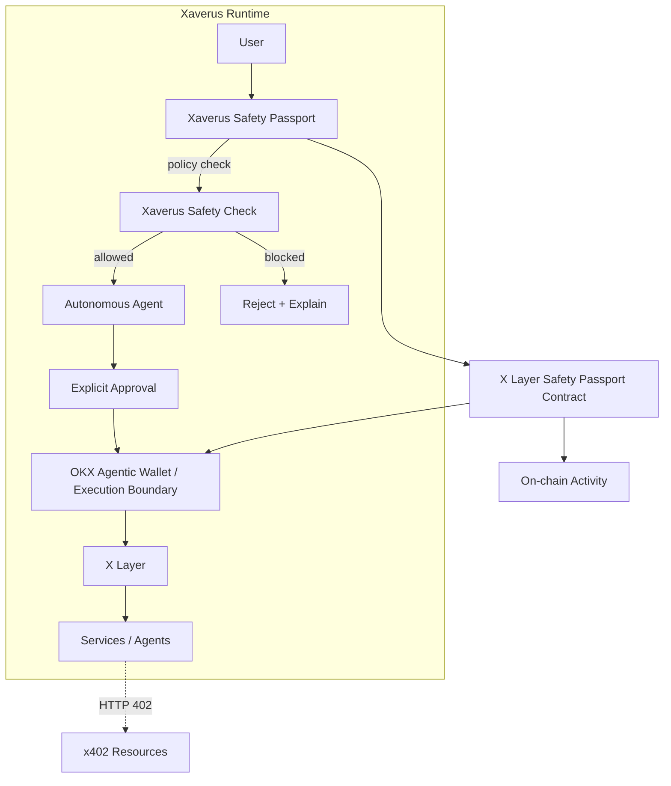

# Xaverus

<div align="center">

**Safe Agent Passport for Autonomous Onchain Agents**

[](https://www.okx.com/xlayer)
[](https://web3.okx.com/)
[](https://nextjs.org/)
[](https://www.typescriptlang.org/)
[](https://www.x402.org/)

**Intent → Safety Passport → Approval → Agent → Wallet → X Layer**

[Live App](https://xaverus.vercel.app) · [Demo](https://youtube.com/watch?v=jTOAmIWEGDs) · [Build Log](BUILD_LOG.md)

</div>

---

## About Xaverus

Xaverus is a **user-controlled safety layer for autonomous onchain agents**.

The agent can plan and coordinate actions, while deterministic policy controls remain between the user's intent and the wallet execution boundary.

### Core idea

> **Let agents act. You keep the keys.**

Xaverus turns agent payment intent into a policy decision before execution.

---

## What Xaverus does

- 🛡️ **Per-transaction spend cap** — limits individual payment intents.
- 📅 **Daily spending cap** — limits cumulative daily spend.
- ✋ **Explicit approval gate** — keeps user approval in the workflow.
- 🛑 **Kill switch** — immediately stops policy-approved actions.
- 🔎 **Intent preview** — exposes the proposed asset, network, amount, and approval requirement.
- 📋 **Activity trail** — records policy decisions and safety actions.
- 🤖 **OKX AI / A2MCP** — exposes Xaverus Safety Check as a machine-readable policy service.
- 💸 **x402 readiness** — includes a server-side x402 seller flow for machine-to-machine paid resources.
- ⛓️ **On-chain Safety Passport** — policy, daily spend, kill switch, authorization and activity are anchored on X Layer.
- 🧱 **Server-side decision layer** — the browser is treated as an untrusted UI; the wallet remains the signing boundary.
- 🪪 **Human-proof minting** — a Safety Passport is minted only with a Human Proof: an X account verified through X OAuth plus a wallet-signed OKX UID claim (the UID is a user-signed claim, never a verification by OKX).
- 🔌 **TapeOut integration** — the mint rule is enforced openly by a small NAND policy circuit evaluated read-only through `eval()`, and each Human Proof is anchored as a hash file in the circuit's container.
- 🔑 **Wallet connect for minting** — log in with email (Privy creates an embedded wallet automatically) or connect OKX Wallet natively with one button; the wallet is moved to X Layer automatically and the address fills itself in.

---

## Live safety behavior

The production safety service has been exercised with three deterministic scenarios:

| Scenario | Policy | Result |
|---|---|---|
| **1 USDC** | Per-tx limit: 5 USDC | **ALLOWED** |
| **6 USDC** | Per-tx limit: 5 USDC | **BLOCKED** |
| **1 USDC + kill switch** | Safety disabled | **BLOCKED** |

The policy service is decision-only. It does **not** sign or move funds.

---

## Why Xaverus

| Capability | Typical agent flow | **Xaverus** |
|---|---|---|
| Spending control | Prompt-level instruction | **Deterministic limits** |
| Daily budget | Often external/manual | **Built into policy** |
| Approval | Agent-dependent | **Explicit approval gate** |
| Emergency stop | Not always available | **Kill switch** |
| Intent visibility | Tool call details | **Intent preview** |
| Auditability | Application logs | **Activity / proof-of-action model** |
| Wallet boundary | Agent may call wallet directly | **Safety layer before execution boundary** |
| Machine service | Custom integration | **OKX AI A2MCP service** |
| Paid machine calls | Optional | **x402 seller flow** |

---

## Architecture



### Security boundary

The browser is treated as an **untrusted UI**.

Secrets and signing material should remain outside client code. Production execution should re-check policy immediately before signing and additionally enforce appropriate simulation, risk, recipient, replay, rate-limit, and audit controls.

Xaverus is designed as **defense-in-depth**, not as a claim of perfect security.

---

## OKX AI integration

Xaverus is registered as an **A2MCP ASP** on X Layer mainnet.

| Field | Value |
|---|---|
| ASP | **Xaverus** |
| Agent ID | **13805** |
| Role | **ASP** |
| Chain | **X Layer mainnet · 196** |
| Service | **Xaverus Safety Check** |
| Service type | **A2MCP** |
| Service ID | `010e5352-7c1a-4d10-a655-93eb2e77611d` |
| Fee | **0 USDT** |
| Endpoint | `/api/agent/safety-check` |
| Listing state | **Under review** |
| A2A communication | **Online / ready** |

> The listing is currently under review. Xaverus does not represent the ASP as approved or listed.

### Safety Check request

```json
{
  "amount": 1,
  "spentToday": 0,
  "policy": {
    "perTx": 5,
    "daily": 25,
    "approvalRequired": true,
    "autoStop": true,
    "enabled": true
  }
}
```

---

## x402 integration

Xaverus includes an OKX x402 seller service:

```
https://xaverus.vercel.app/api/x402/service
```

The production seller is configured for **X Layer mainnet (eip155:196)** and uses server-only configuration. A real **$0.01 USD₮0** buyer payment has now been verified on X Layer mainnet with a successful on-chain receipt.

See [docs/X402_INTEGRATION.md](docs/X402_INTEGRATION.md) and the [verified mainnet payment evidence](docs/X402_MAINNET_PAYMENT_EVIDENCE.md).

---

## Human-proof minting (Build X Series)

New in the OKX X Layer Build X Series: before a wallet can mint a Safety
Passport, it must present a **Human Proof** — an X Binding (X.com account
verified through X OAuth, tied to the wallet by signature) plus an OKX
UID Claim (the user's OKX UID, declared by the user and bound to the
wallet by signature). The Mint Gate refuses any mint without a valid
Human Proof. Minting deploys a new Safety Passport contract owned by the
wallet; it is not a token mint.

The OKX UID is always a **user-signed claim, never a verification by
OKX**, and no passwords are ever requested or stored. The mint rule is
enforced openly by a small TapeOut NAND policy circuit evaluated
read-only through `eval()`, and each proof is anchored as a hash file in
the circuit's container.

Wallet connect is part of the same new work: the mint page offers Privy
login (email, which creates an embedded wallet automatically, or an
external wallet) and a native OKX Wallet button, both feeding one shared
wallet adapter that moves the wallet to X Layer and fills the address in
automatically. Typing an address by hand stays available as a fallback,
and without a Privy App ID the app runs exactly as before.

- Mint page: `/mint`
- [Human-proof minting guide](docs/HUMAN_PROOF_MINTING.md)
- [TapeOut integration](docs/TAPEOUT_INTEGRATION.md)
- [Build X Series submission draft](docs/BUILD-X-SUBMISSION.md)
- [X Developer Portal guide](docs/X_DEVELOPER_PORTAL_GUIDE.md)
- [Privy setup guide](docs/PRIVY_SETUP_GUIDE.md)
- [OKX Wallet guide](docs/OKX_WALLET_GUIDE.md)

Status: implemented and tested locally. The registry and factory
contracts are not deployed yet, our policy circuit is not taped out yet,
and no proof has been anchored on mainnet — see the submission draft for
the honest TODO list.

---

## Product flow

```text
Discover Agent
      ↓
Open Agent
      ↓
Configure Safety Passport
      ↓
Preview Intent
      ↓
Policy Check
      ↓
ALLOW / BLOCK
      ↓
Explicit Approval
      ↓
Wallet / Execution Boundary
      ↓
Activity Record
```

The marketplace UI includes:

- Marketplace
- Agent detail
- My Agents
- Safety Passport
- Activity
- Launch Pass concept

---

## API surfaces

| Method | Path | Purpose |
|---|---|---|
| POST | `/api/agent/safety-check` | On-chain Safety Passport decision |
| GET | `/api/agent/passport` | On-chain passport state |
| POST | `/api/agent/authorize` | Build wallet authorization transaction |
| GET | `/api/agent/manifest` | A2MCP service manifest |
| GET | `/api/x402/service` | x402-protected service |
| GET | `/api/launch-pass` | Launch Pass status / configuration boundary |
| GET | `/api/mint/x/authorize` | Start X OAuth for a wallet (redirects to X) |
| GET | `/api/mint/x/callback` | X OAuth callback; records the X Binding |
| POST | `/api/mint/message` | Build the binding message the wallet signs (POST so the raw UID never travels in a URL) |
| POST | `/api/mint/claim` | Submit the signed binding; receive a Human Proof |
| GET | `/api/mint/proof` | Read the public Human Proof for a wallet |
| GET | `/api/mint/binding` | Read the X Binding for a wallet |
| POST | `/api/mint/passport` | Mint Gate: check the proof, evaluate the policy circuit, return mint calldata |
| GET | `/api/mint/anchor` | Verify a wallet's anchored proof against the on-chain SHA-256 |

The Launch Pass payment route is intentionally **not enabled** in the current production deployment until its x402 activation path is revalidated against the installed SDK.

---

## Project structure

```text
xaverus/
├── app/
│   ├── agents/              # My Agents
│   ├── activity/            # Activity / audit view
│   ├── safety/              # Safety Passport
│   ├── mint/                # Human-proof minting page
│   │   ├── page.tsx              # Four-step mint page
│   │   ├── privy-wallet-connect.tsx # Privy login button
│   │   └── okx-wallet-connect.tsx   # Native OKX Wallet button
│   └── api/
│       ├── agent/            # OKX AI safety service
│       ├── x402/             # x402 seller
│       ├── mint/             # Human-proof mint API routes
│       └── launch-pass/      # Launch Pass boundary
├── components/
│   └── providers.tsx         # Client-side providers (Privy, optional)
├── lib/
│   ├── safety.ts             # Deterministic policy engine
│   ├── human-proof.ts        # Human Proof core library
│   ├── human-proof-store.ts  # Shared proof store singleton
│   ├── human-proof-file-store.ts # File-backed proof store
│   ├── mint-response.ts      # Shared mint-route response shapes
│   ├── mint-tapeout.ts       # Policy-circuit check for the mint decision
│   ├── mint-transaction.ts   # Factory mint calldata
│   ├── tapeout-eval-log.ts   # Persistent eval() audit log
│   ├── x-oauth.ts            # X OAuth 2.0 with PKCE
│   ├── tapeout-circuit.ts    # Policy circuit simulator + eval() reader
│   ├── tapeout-anchor.ts     # Proof anchoring (SiteRegistry)
│   ├── wallet-adapter.ts     # Shared wallet seam (sign, send, switch)
│   ├── x-layer-chain.ts      # The one X Layer chain definition
│   ├── privy-config.ts       # Privy config builder (pure function)
│   ├── privy-wallet.ts       # Privy wallet behind the wallet seam
│   └── okx-wallet.ts         # Native OKX Wallet module
├── circuits/
│   └── policy-circuit.v      # TapeOut policy circuit (Verilog)
├── contracts/
│   ├── XaverusPassport.sol             # Safety Passport (unchanged)
│   ├── XaverusHumanProofRegistry.sol   # Proof registry
│   └── XaverusPassportFactory.sol      # Minting factory
├── scripts/
│   ├── x402-e2e-test.mjs     # x402 buyer probe
│   ├── mint-routes-e2e.mjs   # Automated mint-route tests (npm run test:routes)
│   └── anchor-proof.mjs      # Anchor a Human Proof (dry-run by default)
├── docs/
│   ├── ARCHITECTURE.md
│   ├── OKX_INTEGRATION.md
│   ├── X402_INTEGRATION.md
│   ├── HUMAN_PROOF_MINTING.md
│   ├── TAPEOUT_INTEGRATION.md
│   ├── PRIVY_SETUP_GUIDE.md
│   ├── OKX_WALLET_GUIDE.md
│   └── BUILD-X-SUBMISSION.md
├── BUILD_LOG.md
└── README.md
```

---

## Quick start

```bash
git clone https://github.com/wadezigh96/Xaverus.git
cd Xaverus
npm install
npm run dev
```

Open:

```
http://localhost:3000
```

---

## Build evidence

Xaverus was extended during the official OKX Dev Day build period with meaningful functionality including:

- OKX AI A2MCP service registration
- X Layer mainnet service configuration
- Server-side safety policy endpoint
- x402 seller integration
- x402 buyer E2E probe
- verified X Layer mainnet x402 settlement evidence
- X Layer mainnet-only x402 seller configuration
- production diagnostics
- marketplace and Safety Passport UI
- build-period documentation and evidence

See [BUILD_LOG.md](BUILD_LOG.md) and the [commit history](https://github.com/wadezigh96/Xaverus/commits/main/).

---

## Submission

**OKX Dev Day 2026 · Build a Company**

- Repository: [github.com/wadezigh96/Xaverus](https://github.com/wadezigh96/Xaverus)
- Live product: [xaverus.vercel.app](https://xaverus.vercel.app)
- Demo: [YouTube](https://youtube.com/watch?v=jTOAmIWEGDs)
- OKX AI service: **Xaverus Safety Check**
- A2MCP ASP: **13805 · under review**
- Demo duration: **3 minutes**

---

<div align="center">

**XAVERUS**

*Let agents act. You keep the keys.*

[Live](https://xaverus.vercel.app) · [GitHub](https://github.com/wadezigh96/Xaverus) · [Demo](https://youtube.com/watch?v=jTOAmIWEGDs)

</div>
